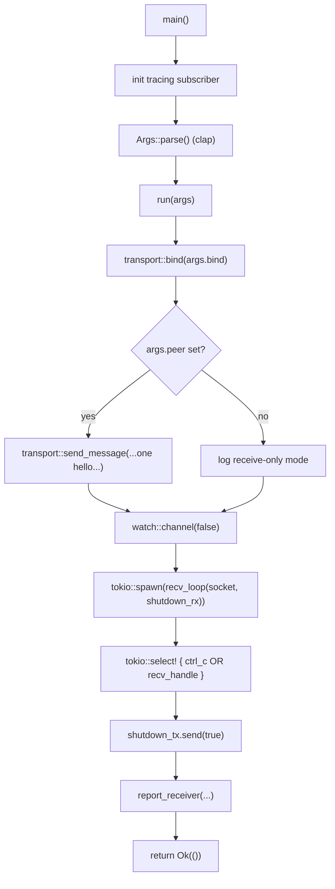
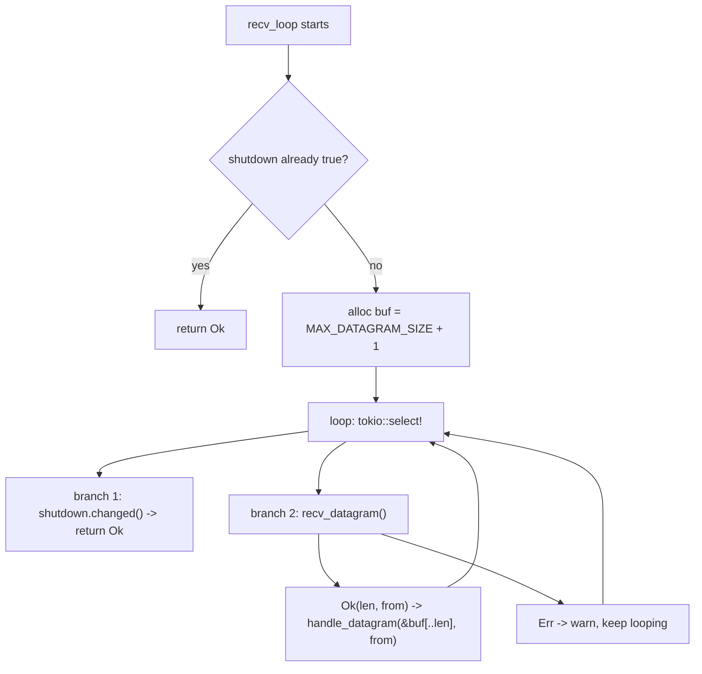

# 02 — Code flow

This is the runtime story: what executes, in what order, and where control goes.
For the *why* behind each decision, see [01-intuition.md](./01-intuition.md).

## Entry point → shutdown



## Step by step

### 1. `main` (`src/main.rs:28`)

```rust
#[tokio::main]
async fn main() -> Result<(), Box<dyn Error>> {
    tracing_subscriber::fmt()...init();
    run(Args::parse()).await
}
```

Three jobs, then out of the way:

- `#[tokio::main]` spins up the async runtime and lets us write `async fn main`.
- The `tracing_subscriber` line turns on logging so `info!`/`warn!` actually print.
- `Args::parse()` is clap reading `argv`; a bad flag exits here with a help message.
- It delegates the real work to `run(...)` and returns the result.

Keeping `main` thin means the logic lives in a testable `run` function.

### 2. `run` (`src/main.rs:38`) — the orchestration

This is the heart. It does five things in order.

**a. Bind the socket**

```rust
let socket = transport::bind(args.bind).await?;
```

`?` means "if this returns an `Err`, stop and bubble it up". If the port is
taken, we never reach the rest of the function.

**b. Send one startup message (optional)**

```rust
if let Some(peer) = args.peer {
    let payload = format!("hello from {}", args.bind);
    transport::send_message(&socket, peer, payload.as_bytes()).await?;
}
```

`if let Some(peer)` means: only run this when `--peer` was provided. `wire::encode`
runs inside `send_message`, so an oversized payload surfaces as an error here.

**c. Set up a shutdown channel**

```rust
let (shutdown_tx, shutdown_rx) = watch::channel(false);
```

`watch` is a one-to-many "broadcast the latest value" channel. `true` will mean
"everyone stop". We hand the **receiver** to the loop and keep the **sender**.

**d. Spawn the receive loop**

```rust
let mut recv_handle = tokio::spawn(transport::recv_loop(socket, shutdown_rx));
```

`tokio::spawn` moves the future onto the runtime and returns a `JoinHandle`.
The socket and the receiver are *moved* into the task — the main function no
longer owns them. From here on, receive runs concurrently with everything below.

**e. Wait for the first of two events**

```rust
let early_exit = tokio::select! {
    _ = tokio::signal::ctrl_c() => { info!(...); None }
    result = &mut recv_handle => Some(result),
};
```

`tokio::select!` waits on **both** branches and takes whichever completes first:

- **Ctrl+C** → `early_exit = None` (user asked us to stop).
- **recv task ended on its own** → `early_exit = Some(join result)` (e.g. socket error).

Note `&mut recv_handle`: we borrow the handle rather than consume it, because we
might still need to `.await` it later in the Ctrl+C path.

### 3. Shutdown (`src/main.rs:63`)

```rust
let _ = shutdown_tx.send(true);
match early_exit {
    Some(result) => report_receiver(result),
    None => report_receiver(recv_handle.await),
}
```

- Send `true` so the receive loop knows to stop.
- If the task already ended (`Some`), report *its* result directly.
- If Ctrl+C won (`None`), `.await` the handle now to collect the result, then report.

Either way `report_receiver` collapses the double-wrapped result
`Result<io::Result<()>, JoinError>` into one of three log lines: clean stop,
IO error, or join/panic error.

## What the receive loop does (`src/transport.rs:32`)



Two things to notice:

- **`+1` buffer.** We size the buffer one byte over the cap so an oversized
  datagram reads back *truncated* rather than being silently accepted whole.
  Truncation is then caught in `decode` as `DatagramTooLarge`.
- **`&buf[..len]`.** UDP tells us how many bytes actually arrived; slicing to
  that length keeps us from decoding stale bytes from a previous, larger packet.

## What `handle_datagram` does (`src/transport.rs:57`)

```rust
match wire::decode(datagram) {
    Ok(payload) => info!(... "received message"),
    Err(err @ WireError::DatagramTooLarge { .. }) =>
        warn!(... "ignored oversized or truncated datagram"),
    Err(err) => warn!(... "rejected malformed datagram"),
}
```

A single match separates the *expected* failure (oversized → a distinct warning)
from every other bad-input case. Crucially, **no branch returns or breaks** — a
bad datagram is logged and dropped, and the loop keeps going. Robustness over
strictness: one bad packet must never kill the listener.

## The whole picture in one sentence

> `main` parses and configures → `run` binds, optionally says hello, spawns a
> receive task, and blocks on `select!` → the loop frames in and out forever
> until shutdown or Ctrl+C, and every bad datagram is logged-and-skipped.
