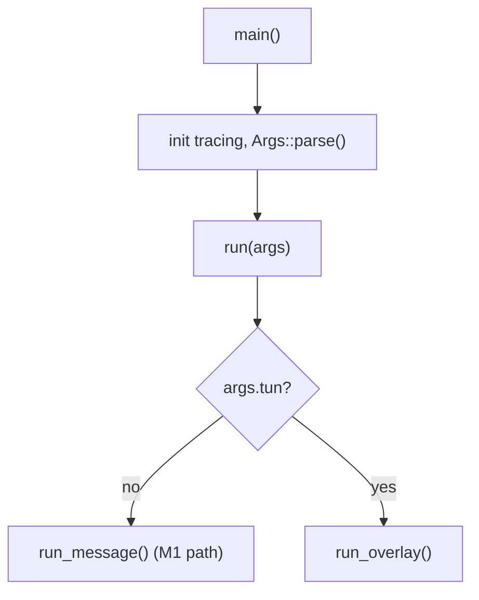
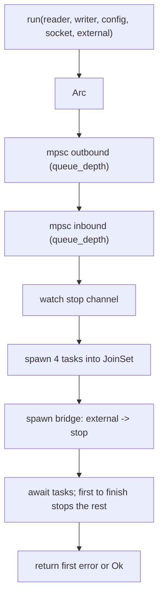
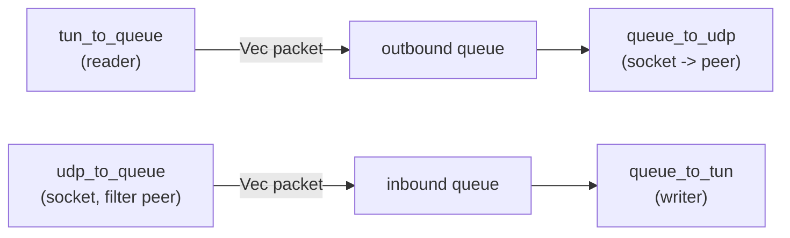

# M2 — Code flow

Runtime story of overlay mode. For the M1 message path, see
[../02-code-flow.md](../02-code-flow.md).

## Entry: `main` dispatches on `--tun`



`run` (`src/main.rs:66`) is a two-line switch. Everything below is the `--tun`
branch.

## `run_overlay` (`src/main.rs:108`)

```text
1. require --peer, --address, --peer-address
2. pick mtu (default 1420), reject mtu > MAX_PAYLOAD_LEN
3. TunDevice::open(tun_config)      <- needs root
4. device.split() -> (reader, writer)
5. transport::bind(bind) -> UdpSocket
6. watch::channel(false)
7. spawn overlay::run(reader, writer, cfg, socket, shutdown_rx)
8. select! { ctrl_c  OR  handle }
9. send shutdown(true); report result
```

Step 3 is where the kernel creates the `utun`, sets its address/destination/netmask,
sets the MTU, and brings it up. Step 4 turns the one device into independent read
and write halves. Steps 7–9 are the same lifecycle shape as M1.

## `overlay::run` (`src/overlay.rs:36`)



The four tasks:



### `tun_to_queue` (`src/overlay.rs:114`) — TUN → queue

- Loop, `select!` on `stop.changed()` vs `reader.recv(&mut buf)`.
- On a packet: `packet::validate`. If good, `outbound.send(packet).await`
  (awaiting is the backpressure). If bad, warn + drop and keep looping.
- Read error → warn and return `Err` (fatal), which eventually stops the tunnel.

### `queue_to_udp` (`src/overlay.rs:149`) — queue → UDP

- `select!` on stop vs `outbound.recv()`.
- On a packet: `transport::send_message(&socket, peer, &packet)` — encodes the
  M1 frame and sends. Send errors are logged, not fatal.

### `udp_to_queue` (`src/overlay.rs:174`) — UDP → queue

- Reads raw datagrams, then `wire::decode`.
- **Rejects anything not from `peer`** before doing anything else.
- `packet::validate` on the decoded payload; good → `inbound.send().await`, bad →
  warn + drop.

### `queue_to_tun` (`src/overlay.rs:220`) — queue → TUN

- `select!` on stop vs `inbound.recv()`.
- `writer.send(&packet).await`. A write error is fatal for this task.

## Shutdown

Two triggers, one path:

- `main` sends `true` on the `watch` channel after Ctrl+C (or the task ended).
- The bridge task inside `run` (`src/overlay.rs:76`) watches `external` and
  flips the internal `stop` channel.

When *any* task finishes, `run` sends `stop(true)`, so the others wind down too;
then it returns the first error it saw (or `Ok`). Dropping the sender also wakes
`changed()` with an error, which the loops treat as "stop".

## Where packets can be dropped (and that's fine)

| Stage | Condition | Action |
| ----- | --------- | ------ |
| `wire::decode` | bad frame / oversized | warn, drop |
| `udp_to_queue` | not from peer | warn, drop |
| `packet::validate` | malformed IP | warn, drop |
| encode on send | payload too big for frame | warn, drop |

None of these are fatal. Only IO errors on the device/socket stop the tunnel.
